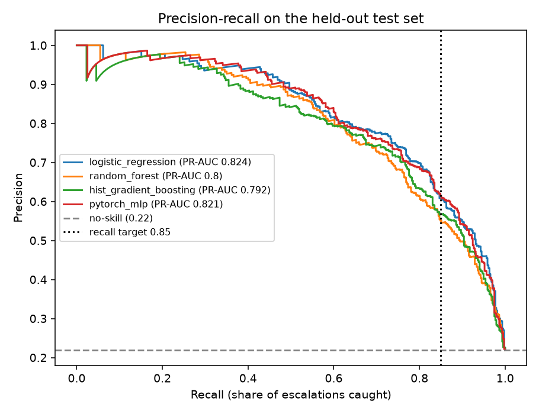
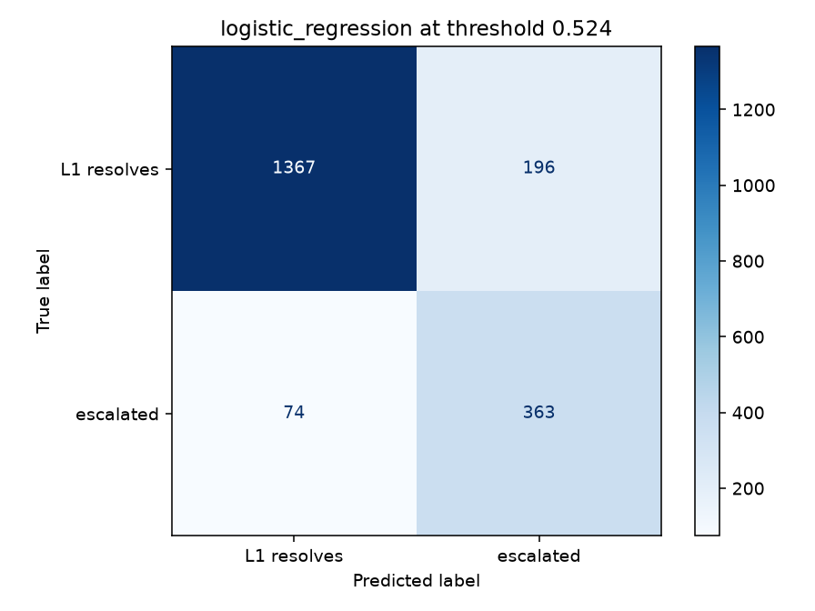

# Results

Dataset: 10000 synthetic tickets, escalation rate 21.8%. 80/20 stratified split; all model selection and threshold tuning on the training set only.

## Cross-validation (5-fold, training set)

| Model | ROC-AUC | PR-AUC | F1 @0.5 |
| --- | --- | --- | --- |
| logistic_regression | 0.932 ± 0.005 | 0.812 ± 0.008 | 0.716 ± 0.007 |
| random_forest | 0.91 ± 0.007 | 0.77 ± 0.01 | 0.712 ± 0.01 |
| hist_gradient_boosting | 0.909 ± 0.008 | 0.764 ± 0.009 | 0.712 ± 0.014 |
| dummy_prior | 0.5 ± 0.0 | 0.218 ± 0.0 | 0.0 ± 0.0 |

Selected by PR-AUC: **logistic_regression** (logistic regression C = 1.0).

## Held-out test set (threshold tuned for recall ≥ 0.85)

| Model | Threshold | ROC-AUC | PR-AUC | Precision | Recall | F1 | Brier | FN (missed) | FP |
| --- | --- | --- | --- | --- | --- | --- | --- | --- | --- |
| logistic_regression | 0.524 | 0.93 | 0.824 | 0.649 | 0.831 | 0.729 | 0.1 | 74 | 196 |
| random_forest | 0.321 | 0.914 | 0.8 | 0.588 | 0.822 | 0.685 | 0.092 | 78 | 252 |
| hist_gradient_boosting | 0.166 | 0.915 | 0.792 | 0.569 | 0.847 | 0.681 | 0.093 | 67 | 280 |
| pytorch_mlp | 0.502 | 0.927 | 0.821 | 0.616 | 0.849 | 0.714 | 0.105 | 66 | 231 |
| rule_based (no ML) | – | – | – | 0.436 | 0.751 | 0.552 | – | – | – |
| dummy (predict base rate) | – | 0.5 | 0.218 | – | 0 | 0 | – | – | – |

## What drives escalation (permutation importance, PR-AUC drop)

| Input | Importance |
| --- | --- |
| description | 0.2383 |
| error_code | 0.0558 |
| log_seen_before | 0.0353 |
| has_runbook | 0.0285 |
| l1_experience_months | 0.0156 |
| customer_tier | 0.0108 |
| service | 0.0054 |
| reopened | 0.0051 |
| channel | 0.0043 |
| text_length | 0.0039 |

## Logistic regression: strongest signals

| Towards escalation | Weight | Towards L1 resolution | Weight |
| --- | --- | --- | --- |
| text__no known | 1.88 | text__applied | -2.53 |
| text__no | 1.88 | text__workaround applied | -2.53 |
| text__known workaround | 1.88 | text__single | -1.69 |
| text__reset no | 1.77 | text__single customer | -1.69 |
| text__impacted | 1.66 | text__customer affected | -1.69 |
| text__customer funds | 1.66 | text__affected | -1.69 |
| text__funds | 1.66 | text__delay please | -1.3 |
| text__funds impacted | 1.66 | text__asked for | -1.21 |
| text__statement urgent | 1.58 | text__for status | -1.21 |
| text__systems kindly | 1.52 | text__for | -1.21 |
